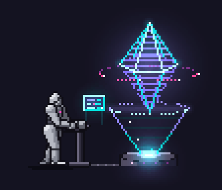

  

  

  

  

<table align="center">
  <tr>
    <td width="58%" valign="top">
      <ul>
        <li>🔭 AI Forward Deployed Engineer at <b>Accenture</b>. I build generative AI apps and agents for enterprise customers and ship them on <b>Google Cloud</b> (Cloud Run, Vertex AI).</li>
        <li>⚙️ I write services in <b>Go, Python and TypeScript</b>: REST and GraphQL APIs, streaming, FastAPI.</li>
        <li>🤖 Ask me about <b>LLM agents</b>, tool calling, MCP servers, RAG and LLM evaluation.</li>
        <li>🌱 Lately I've been sending bug fixes to open source projects like <b>Mermaid</b> and <b>Apache ECharts</b>.</li>
        <li>🎓 B.Tech CSE (AI &amp; ML), Kalasalingam University, 2026. CGPA 8.96.</li>
        <li>🗣️ Fun fact: I speak Telugu, English, Hindi and a little Tamil.</li>
        <li>📫 Reach me on <a href="https://www.linkedin.com/in/tummala-mohan-aditya-35349625a/">LinkedIn</a> or by <a href="mailto:tummalamohanaditya119@gmail.com">email</a>.</li>
      </ul>
    </td>
    <td width="42%" align="center">
      
    </td>
  </tr>
</table>

  
   
  
   
  

  
   
  
   
  
  
  
  
  

  
  

  
  

  

  

**Microsoft Learn Student Ambassador** (2024-2026): 12+ workshops for 200+ engineers on generative AI

  

  
  
  

  
  

  

  <picture>
    <source media="(prefers-color-scheme: dark)" srcset="https://raw.githubusercontent.com/adityajai119/Adityajai119/output/github-contribution-grid-snake-dark.svg" />
    <source media="(prefers-color-scheme: light)" srcset="https://raw.githubusercontent.com/adityajai119/Adityajai119/output/github-contribution-grid-snake.svg" />
    
  </picture>

  
  
  

