  

  

  

<h2 align="center">🧑‍💻 About Me</h2>

<table align="center">
  <tr>
    <td width="58%" valign="top">
      <ul>
        <li>🔭 AI Forward Deployed Engineer at <b>Accenture</b>. I build generative AI apps and agents for enterprise customers and ship them on <b>Google Cloud</b> (Cloud Run, Vertex AI).</li>
        <li>⚙️ I write services in <b>Go, Python and TypeScript</b>: REST and GraphQL APIs, streaming, FastAPI.</li>
        <li>🤖 Ask me about <b>LLM agents</b>, tool calling, MCP servers, RAG and LLM evaluation.</li>
        <li>🌱 Lately I've been sending bug fixes to open source projects like <b>Mermaid</b> and <b>Apache ECharts</b>.</li>
        <li>🎓 B.Tech CSE (AI &amp; ML), Kalasalingam University, 2026. CGPA 8.96.</li>
        <li>🗣️ Fun fact: I speak Telugu, English, Hindi and a little Tamil.</li>
        <li>📫 Reach me on <a href="https://www.linkedin.com/in/tummala-mohan-aditya-35349625a/">LinkedIn</a> or by <a href="mailto:tummalamohanaditya119@gmail.com">email</a>.</li>
      </ul>
    </td>
    <td width="42%" align="center">
      
    </td>
  </tr>
</table>

<h2 align="center">⚙️ How I Ship an AI Agent</h2>

  

<h2 align="center">🛠️ Tech Stack</h2>

  <h3>Languages</h3>
  

  <h3>APIs &amp; Data</h3>
  
   
  

  <h3>Cloud &amp; DevOps</h3>
  

  <h3>AI &amp; Agents</h3>
  
  
  
  
  
  
  

<h2 align="center">📂 Featured Projects</h2>

<table>
  <tr>
    <td width="50%" valign="top">
      <h3>🧱 Fluixy.ai</h3>
      
An AI app builder for Indian users, built on top of bolt.diy. I wrote the Go service behind it, which streams Gemini, OpenAI, Anthropic and Bedrock through one GraphQL API. Prompts work in English, Hindi, Telugu and Tamil, by text or voice.

      

        
        
        
        
        
      

    </td>
    <td width="50%" valign="top">
      <h3>🔎 <a href="https://github.com/adityajai119/DevSensei">DevSensei</a></h3>
      
Ask questions about a whole codebase. It pulls hundreds to thousands of files from a GitHub repo, indexes them for retrieval and lets Gemini answer with that context.

      

        
        
        
        
      

    </td>
  </tr>
  <tr>
    <td width="50%" valign="top">
      <h3>🤖 <a href="https://github.com/adityajai119/GENESIS-AI">GENESIS-AI</a></h3>
      
An agentic chatbot that hands each request to a small team of AI agents, coordinates them and answers by text or voice.

      

        
        
      

    </td>
    <td width="50%" valign="top">
      <h3>🩺 <a href="https://github.com/adityajai119/BC-project">Breast Cancer AI Studio</a></h3>
      
Diagnosis support with three ML models, a SHAP explanation for every prediction and a Gemini chatbot.

      

        
        
        
        
      

    </td>
  </tr>
</table>

<h2 align="center">🏆 Achievements</h2>

| | |
|---|---|
| 🥇 | **Winner**, IBM National Hackathon |
| 🥇 | **1st Prize**, OWASP Hackathon and AR/VR Challenge |
| 🥈 | **Runner-up**, Google GenAI Challenge and CodeChef Codetest |
| ✅ | Qualified for Amazon HackOn and AWS AI for Bharat |

<h2 align="center">🌍 Community</h2>

**Microsoft Learn Student Ambassador** (2024-2026): 12+ workshops for 200+ engineers on generative AI

<h2 align="center">📊 GitHub Analytics</h2>

  

  
  
  

  
  

<h2 align="center">🏅 GitHub Trophies</h2>

  

<h2 align="center">🐍 Contribution Snake</h2>

  <picture>
    <source media="(prefers-color-scheme: dark)" srcset="https://raw.githubusercontent.com/adityajai119/Adityajai119/output/github-contribution-grid-snake-dark.svg" />
    <source media="(prefers-color-scheme: light)" srcset="https://raw.githubusercontent.com/adityajai119/Adityajai119/output/github-contribution-grid-snake.svg" />
    
  </picture>

<h2 align="center">📫 Connect with Me</h2>

  
  
  

  

